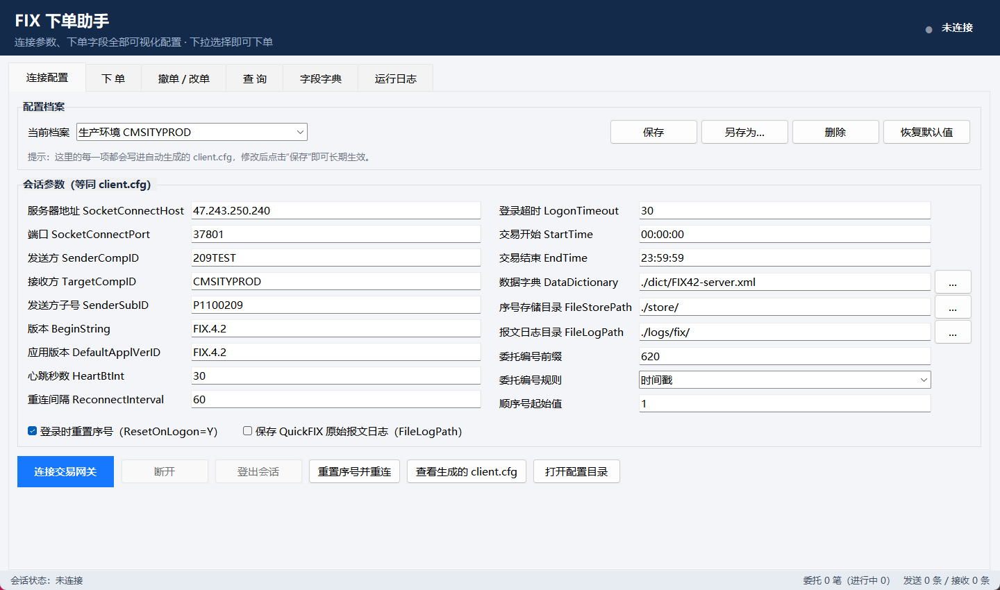
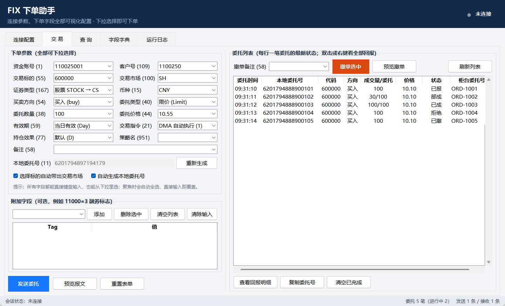
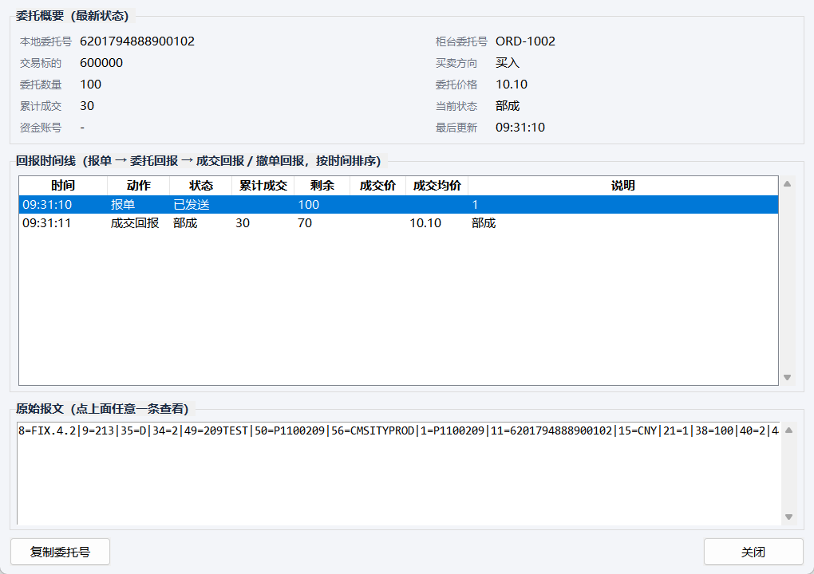
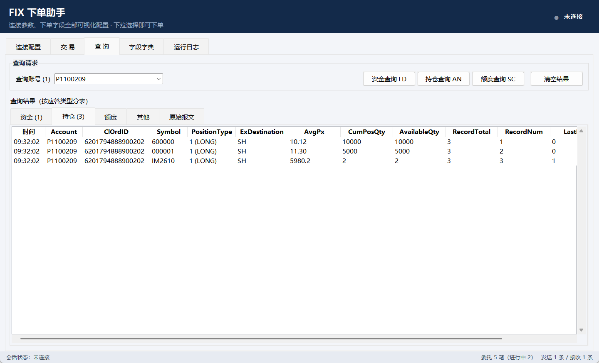
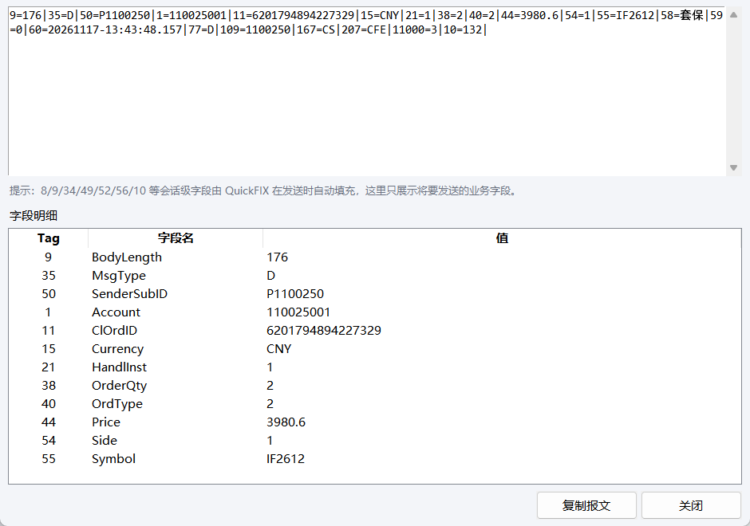

# FIX 下单助手（图形界面版）

## ⬇ 下载（Windows，免安装）

**[点击下载 FIX-Order-Desk.exe](https://github.com/sjn1005815350-lab/fix/releases/latest/download/FIX-Order-Desk.exe)** （约 11 MB）

- 双击即可运行，不需要安装 Python，也不需要命令行。
- 首次运行会在 exe 同级目录生成 `config/`（配置）、`dict/`（FIX 字典）、`logs/`、`store/`、`runtime/`，
  之后所有账号/连接设置都保存在这里。
- 程序没有做代码签名，Windows 可能提示“未知发布者”，点「更多信息 → 仍要运行」即可；
  若杀毒软件误报，加入信任或白名单。
- 建议把 exe 放在**不含中文**的目录（例如 `D:\FIX`），路径含中文时 QuickFIX 可能读不到配置。
- 文件校验（SHA256）：`3B129CD54F89A030E32A228908137198D21A431B3796ABBEF672C0BE2327932C`
  下载后可执行 `certutil -hashfile FIX-Order-Desk.exe SHA256` 核对。
- 历史版本和更新记录见 [Releases](https://github.com/sjn1005815350-lab/fix/releases)。

把 `D:\fix-test含查询\fix-test` 里的命令行脚本（`test.py` / `main.py` / `fix_client.py` /
`fix_application.py` / `model/*.py`）改写成了一个带可视界面的 FIX 下单程序：

- **连接参数全部可视化配置**：截图里的 `SocketConnectPort=37801`、`SocketConnectHost=47.243.250.240`、
  `SenderCompID=209TEST`、`TargetCompID=CMSITYPROD`、`SenderSubID=P1100209` 以及其余 client.cfg
  里的键，都能在界面上改，改完自动生成 `runtime/client_runtime.cfg`。
- **下单内容全部下拉选择**：资金账号、客户号、交易标的、市场、证券类型、买卖方向、委托类型、
  数量、价格、有效期、交易指令、持仓效果、策略名、备注、附加字段——都从下拉框里选，
  选项在「字段字典」页维护，也可以直接在框里临时输入。
- **委托列表与回报分开两个层次**：右侧每行是一笔委托的**最新状态**；双击/右键某一行会弹出这笔委托的**完整回报时间线**（报单 → 委托回报 → 成交回报 / 撤单请求 / 撤单回报 / 撤单拒绝，附原始报文）。
- **选中委托即可撤单**：不用手输委托号，原始委托号、代码、方向、账号都取自选中那一行。
- **查询结果表格化**：资金 / 持仓 / 额度查询应答按字段名解析成表格，同时保留原始报文。
- **运行日志**：所有收发报文、成交回报、错误可过滤、可导出。

## 一、运行

**方式一：直接运行 exe**（推荐给使用者）
下载发行版里的 `FIX-Order-Desk.exe`，双击即可。

**方式二：源码运行**（改成自己的版本）
```bat
python -m pip install -r requirements.txt
run.bat           :: 日常使用（无控制台窗口）
run_debug.bat     :: 排查问题时使用（保留控制台输出）
```

依赖：Python 3.8+、tkinter、QuickFIX（`pip install quickfix`）。

**自己打包 exe**
```bat
python -m pip install pyinstaller
python tools\build_exe.py
```
产物在 `dist/FIX-Order-Desk.exe`。

> ⚠️ 程序目录请放在**不含中文**的路径下（例如 `D:\work\fix`）。QuickFIX 读取配置文件时
> 不支持含中文的路径，程序内部已经通过相对路径规避，但根目录仍是中文时可能打不开。

## 二、界面预览

**连接配置页（截图里的 host / port / SenderCompID / TargetCompID / SenderSubID 等全部可改）**



**交易页（左：下单参数；右：委托列表，每行一笔委托的最新状态，颜色区分进行中/已完成/被拒绝）**



**双击某笔委托弹出的回报时间线（报单、成交回报、撤单回报按时间排列，可看原始报文）**



**查询页（按应答类型分表，字段名来自 FIX 字典）**



**报文预览（发送前核对将要发出的字段）**



## 三、界面说明

| 页签 | 作用 |
| --- | --- |
| 连接配置 | 配置档案管理 + 全部 client.cfg 参数 + 连接 / 断开 / 登出 / 重置序号 |
| 交易 | 下单参数 + 附加字段 + 委托列表（单笔最新状态）+ 回报时间线弹窗 + 撤单（选中即撤） |
| 查询 | 资金 FD / 持仓 AN / 额度 SC 查询，结果按应答类型分表 |
| 字段字典 | 维护每个下拉框的选项、附加字段预设 |
| 运行日志 | 报文流水，按类别过滤、导出 |

快捷键：`Ctrl+Enter` 发送委托，`F5` 刷新委托列表。

### 连接配置

每一项都对应 `client.cfg` 的一个键，点「保存」后写入 `config/settings.json`，下次启动自动带出；
点「查看生成的 client.cfg」可以先看最终文件。可以建多个档案（生产 / 测试）随时切换。

- `ResetOnLogon=Y` 表示每次登录把序号重置为 1，和原脚本保持一致；换网关或换账号前建议点
  「重置序号并重连」，会清掉本地序号文件。
- 「委托编号规则」决定自动生成的 ClOrdID：`前缀 + 毫秒时间戳`（默认，例如
  `6201794888900123`）或 `前缀 + 递增序号`。

### 交易（下单 / 撤单 / 回报同一页）

所有字段下拉选择，也能直接在框里改；聚焦时会自动全选，直接敲数字即可覆盖。
选「交易标的」时会按记忆/规则自动带出「交易市场」（可关掉）。
选「市价」时会自动清空价格，限价单必须填价格。附加字段用于写非标准 tag，
例如 `11000=3`（融券标志），从预设里选或手填 `tag=值` 后点「添加」。
输入框里没提交的内容点「清除输入」（或按 Esc）清掉，表格里已添加的行点「清空列表」清掉。

发送前可以点「预览报文」查看将要发出的 FIX 报文（只组装、不发送），
弹窗里同时列出每个 tag 的字段名，方便核对。

### 委托列表与回报明细

右侧每行是一笔委托的最新状态（委托时间、本地委托号、代码、方向、成交量/委托量、价格、状态、柜台委托号），不会把每条成交回报单独列一行。

要看某一笔订单的完整过程：**双击这一行**（或右键 →「查看回报明细」），弹窗里按时间顺序列出这条委托的
报单、委托回报、成交回报、撤单请求、撤单回报、撤单拒绝；点任意一条，下方显示对应的原始 FIX 报文。

### 撤单

在「委托列表」里选中一笔进行中的委托（也可以在行上点右键），点「撤单选中」→ 确认 → 发出；撤单委托号自动生成，「撤单备注」会写进 58 字段。
撤单的回执（已撤 / 撤单拒绝）会作为时间线里的新记录追加到这笔委托上，列表状态同步更新。「预览撤单」可以先看报文不发送。

### 查询

账号同样是下拉选择。应答按数据字典解析：`FP` 资金、`AP` 持仓、`SP` 额度、`LS` 登录结果，
表格列会自动扩展；切到「原始报文」可以看全文。

## 四、目录结构

```
D:\work\fix
├─ main.pyw                 入口（pythonw 无控制台启动）
├─ run.bat / run_debug.bat  启动脚本
├─ requirements.txt
├─ fixgui\                  程序代码
│   ├─ ui.py                界面（Tkinter）
│   ├─ engine.py            QuickFIX 会话引擎：生成 cfg、连接、发送
│   ├─ application.py       回调：会话事件 / 成交回报 / 查询应答
│   ├─ messaging.py         报文组装（对应原 fix_application.py）
│   ├─ parser.py            报文解析
│   ├─ dictionary.py        FIX 字典（tag→字段名、枚举说明）
│   ├─ models.py            下拉选项与委托记录结构
│   └─ config_store.py      配置持久化
├─ dict\                    FIX42-server.xml / FIX42.xml（从原项目复制）
├─ config\                  运行后生成：settings.json / options.json / orders.json
├─ runtime\                 运行后生成：client_runtime.cfg
├─ store\                   QuickFIX 序号文件
├─ logs\                    控制台日志、可选报文日志
├─ assets\                  程序图标
└─ tools\                   开发自检脚本（selftest / mock_gateway_test / demo / typecheck）
```

## 五、和原脚本的对应关系

| 原脚本 | 现在 |
| --- | --- |
| `client.cfg` | 「连接配置」页，运行时生成 `runtime/client_runtime.cfg` |
| `fix_application.py` 的 `new_order_single` | `fixgui/messaging.py: build_new_order` |
| `order_cancel_request` | `build_cancel_order`（改单暂未使用，界面已去掉） |
| `query_fund_request` 等 | `build_fund_query` / `build_position_query` / `build_quota_query` |
| `log_in` | `build_login`（931 用户名 / 932 密码，界面暂未使用，需要时可恢复） |
| `test.py` 里手填的 JSON | 「交易」「查询」页各控件 |
| `fromApp` 里注释掉的回报处理 | 已启用：成交回报解析后写入委托列表 |

顺带修掉了原脚本里的一个问题：`fromApp` 没有把回报交给 `onMessage`（导致收不到成交回报）。

## 六、自检脚本（开发用）

```bat
python tools\selftest.py            :: 配置、报文组装、字典、界面构建
python tools\mock_gateway_test.py   :: 本机模拟网关，跑通登录→下单→回报（不连真实网关）
```

## 七、常见问题

| 现象 | 处理 |
| --- | --- |
| 登录被拒、提示序号错误 | 点「重置序号并重连」 |
| 提示数据字典不存在 | 检查「连接配置 → 数据字典 DataDictionary」 |
| 提示会话未登录 | 看顶部状态和「运行日志」里的管理报文；等 `35=A` 往返完成再下单 |
| 程序界面字体小/模糊 | 程序已声明 DPI 感知；如仍异常，可调整 Windows 缩放 |
| 启动没有任何反应 | 用 `run_debug.bat` 启动，看控制台报错 |
| 价格/数量敲不进字 | 先确认窗口在前台；中文输入法可切到英文半角，或直接从下拉预设里选（全角数字会自动转半角） |

### 输入小技巧

- 所有下拉框都可以直接键盘输入，聚焦时整段自动选中，输入即覆盖。
- 中文输入法打出的全角数字会自动转成半角（例如 １０．５５ → 10.55），价格框不会因此报非法。
- 市价单不用填价格（选了市价会自动清空），发单时也不会带 44 字段。

